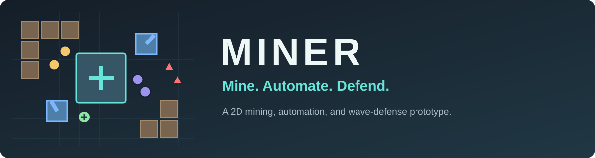

<div align="center">




**Build an automated mining operation. Keep your base alive against increasingly powerful enemy waves.**

[Gameplay](#gameplay) · [Buildings](#buildings) · [Mission & ranking](#mission--ranking) · [Tutorial](#tutorial) · [Controls](#controls) · [Getting started](#getting-started)

</div>

## Gameplay

**Miner** combines resource gathering, base building, automation, and wave defense. Start with your character, mine nearby blocks, and return the resources to your base to earn money. Invest in mining drones, transport, defenses, and repairs to survive the **20-wave main mission**, defeat its two bosses, and secure your base. After victory, continue the same run in **Endless Freeplay**.

```text
MINE → SELL → AUTOMATE → FORTIFY → SURVIVE
                 ↑                    │
                 └──── UPGRADE ────────┘
```

The main map contains **2,000 resource blocks** around a central base. Each block yields resources in four mining steps. Harder layers require higher mining levels, and limited carrying capacity makes delivery routes important. Resources are finite, so economic expansion and defense compete for the same budget.

## Buildings

| Building | Role |
| :--- | :--- |
| ⛏️ **Collector** | Deploys mining drones and stores their earnings. Collect the money yourself or use cash-collection drones to automate delivery. |
| 🛡️ **Barracks** | Produces melee combat drones that intercept enemies. Lost drones are replaced through a production queue. |
| 🎯 **Tower** | Fires projectiles at nearby enemies. Upgrade its health, simultaneous shots, and firing rate. |
| 🔧 **Workshop** | Deploys mechanics to repair the base, towers, and stationary combat drones on their barracks grounds. Only one workshop can exist at a time. |

Buildings occupy **2 × 2 grid cells** and take time to construct. Right-click a building to inspect its drones, upgrades, and statistics. Demolition requires confirmation and refunds **75% of the actual construction price**, rounded down. Stored earnings and carried mining resources are recovered, and global upgrades remain unlocked.

## Progression & simulation

- **Global skill tree:** Improve mining levels, drone counts, movement speed, carrying capacity, health, damage, tower firepower, and repair performance.
- **Progress-based limits:** Building caps and upgrade availability expand as waves are defeated.
- **Growing enemy waves:** Normal waves increase in numbers and health. Boss encounters replace the normal enemies in waves **10** and **20** of the main mission.
- **Repair priorities:** Mechanics prioritize the base, then towers, then eligible combat drones. Towers and combat drones are reserved for one mechanic at a time; multiple mechanics can repair the base together.
- **Drone traffic:** Hard circular collisions allow drones to push one another. Drones navigate around obstacles and find parking space without fixed slots. Mining jobs and cash pickups are reserved to reduce duplicate assignments. Bosses push smaller drones aside without being displaced, so barracks drones cannot pin them in place.
- **Early wave bonus:** Start the next wave immediately with the button beside the countdown. Each full remaining simulation second awards **$1**, counted as revenue, and the next countdown resets. Existing enemies stay in play. The button is disabled while the game or wave timer is paused and returns after wave 20 only when entering Endless Freeplay.
- **Simulation controls:** Pause or cycle through **1×, 1.5×, 2×, and 3×** speed. Zoom and pan the map within its camera bounds.
- **Persistent statistics:** Track gathered resources, fully mined blocks by hardness, and defeated enemies across runs.
- **Options & language:** English is the default language. Switch between English and German from the start menu; your preference is saved automatically.

## Mission & ranking

Survive all **20 waves** to reach **MISSION ACCOMPLISHED**. Two boss encounters replace the normal enemies in their waves:

| Wave | Boss | Behavior |
| :--- | :--- | :--- |
| **10** | **MidBoss** | Has **20×** the health of a normal wave-10 drone and moves at **half speed**. |
| **20** | **FinalBoss** | Has **50×** the health of a normal wave-20 drone and spawns **three normal Swarmer drones every five simulation seconds** at its current position. |

Both bosses head straight for the base, ignore attacks when choosing their target, and push defending drones out of their way. Defeating a boss completes its wave; any surviving Swarmers disappear when the FinalBoss is defeated. Earlier waves must also be cleared to win the mission.

The victory screen shows **real play time**, **enemies neutralized**, **fully mined blocks**, and **total revenue**. Choose **Back to Main Menu**, **Retry**, or **Endless Freeplay** to continue with your current base, resources, and upgrades from wave 21 onward. If the base is destroyed, the defeat screen shows the same statistics plus the wave reached, with options to retry or return to the menu.

Play time excludes pauses and measures real time regardless of simulation speed: ten minutes played at **3×** speed appear as **10:00**, even though thirty minutes pass in the simulation. Revenue counts income credited during the run, excluding starting money and building sale proceeds.

Open **Ranking** in the start menu and choose a category:

- **20-Wave Mission:** All recorded mission victories, sorted by shortest real play time. The result is saved on victory and remains unchanged during Endless Freeplay.
- **Endless Game:** Runs in which at least **wave 21 has been defeated**, saved when returning to the main menu through the exit confirmation or defeat screen. Results show the highest defeated wave and are sorted by that wave first, then by shortest play time for ties. Cancelling the exit or choosing Retry does not create an entry.

Both categories include real play time, defeated enemies, fully mined blocks, and revenue. Endless statistics cover the full run, including the initial 20-wave mission. Rankings are stored locally; earlier runs cannot be reconstructed.

## Tutorial

Choose **Tutorial** from the start menu for a guided introduction on a smaller map with **264 blocks**, six resource rings, and hardness levels **1–3**.

The tutorial starts with **20 money**, no active wave timer, and no building or skill menus. Income milestones gradually introduce collectors, economic upgrades, base skills, harder resources, and defenses. Messages pause the simulation, while blinking buttons highlight newly available actions.

After one barracks and two towers are finished, a **10-second preparation period** leads into the **100-second countdown** to the first wave. Defeating that wave introduces the workshop and repairs.

## Controls

| Input | Action |
| :--- | :--- |
| **WASD / Arrow keys** | Move the character; select entries while a menu is open |
| **Left-click / Hold** | Navigate or direct the character toward resources |
| **Near a mineable block** | Automatically mine until carrying capacity is reached |
| **B** | Toggle the building menu |
| **J** | Toggle the skill tree |
| **Enter / E** | Confirm the selected menu entry or keyboard placement |
| **Right-click a building** | Open its information and demolition menu |
| **Hold right mouse button + Drag** | Pan the camera |
| **Mouse wheel** | Zoom the map; scroll menus when hovered |
| **Escape / Right-click while placing** | Cancel placement or close the current menu |
| **Top-left buttons** | Resume, pause, or change simulation speed |

## Getting started

### Play on Windows

1. Open the [GitHub Releases](https://github.com/FutuRazor/miner/releases).
2. Download the Windows build from the release assets.
3. If the download is an archive, extract all files into one folder.
4. Launch the **`.exe`** and choose the main game or the tutorial.

**No Godot installation is required to play the Windows build.**

### Run from source

1. Install **Godot 4.7**. The project is developed and tested with **Godot 4.7.2**.
2. Clone or download this repository.
3. Import **`project.godot`** into Godot.
4. Press **F5** to run the project.

> **Prototype status:** Mechanics and balance are actively evolving. The game is available in English and German.

<details>
<summary><strong>Project structure & tests</strong></summary>

| Path | Contents |
| :--- | :--- |
| `scenes/` | Start menu, main world, tutorial, and interface scenes |
| `scripts/world.gd` | Shared world, economy, construction, and wave logic |
| `scripts/spawn_manager.gd` | Normal waves, boss encounters, and Swarmer spawning |
| `scripts/boss.gd` | Boss behavior, Swarmer timer, and boss-defeat signal |
| `scripts/meta_stats.gd` | Persistent statistics and victory rankings |
| `scripts/balance.gd` | Prices, caps, and upgrade unlock schedules |
| `scripts/tutorial_world.gd` | Tutorial milestones and restricted progression |
| `scripts/drone*.gd` | Drone behavior, navigation, and collision handling |
| `tests/` | Headless gameplay and interface regression tests |

Run an individual test from the repository root:

```sh
godot --headless --path . --script tests/tutorial_test.gd
```

Replace `godot` with the path to your Godot executable if it is not on your system's `PATH`.

</details>
